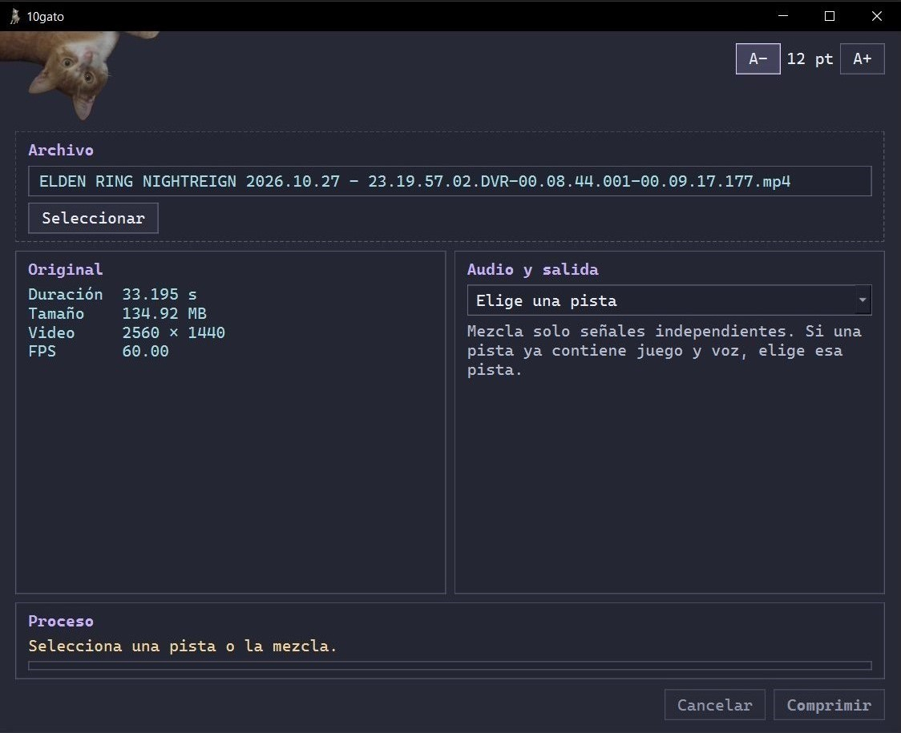

# 10gato

Programa para reducir automáticamente videos cortos a 10 MB y poder compartirlos en Discord (basura de límite de 10 MB...)

## Descargar y abrir

1. Entra en la sección [**Releases**](../../releases) de este repositorio y descarga el ZIP de la versión más reciente.
2. Haz clic derecho sobre el ZIP y selecciona **Extraer todo**.
3. Abre la carpeta extraída y ejecuta `10gato.exe`.

No requiere instalación ni descargar programas adicionales.

## Instrucciones nivel pollazo

1. Arrastra un video a la ventana o pulsa **Seleccionar** para buscarlo.
2. Si aparecen varias pistas de audio, elige la que quieras conservar. Una pista puede contener, por ejemplo, el sonido del juego o tu micrófono. Usa **Mezclar todas** solo si quieres juntar sonidos separados; si una pista ya contiene todo, selecciona esa.
3. Pulsa **Comprimir** y espera a que termine. Puedes detener el proceso con **Cancelar**.
4. Pulsa **Mostrar en carpeta** para encontrar el resultado.

La copia se guarda en la misma carpeta que el original, con un nombre como `mi_video_10MB.mp4`. Si ese nombre ya existe, se añade un número para no sobrescribirlo.

## Tener en cuenta...

- La calidad de imagen puede reducirse para cumplir el límite de tamaño, especialmente en videos largos.
- El archivo original no se modifica.

## Licencia

El código propio de **10gato**, con derechos de autor de `gato6a7o`, se distribuye bajo la GNU GPL versión 3 o cualquier versión posterior. Consulta el archivo [`LICENSE`](LICENSE).

Las imágenes de `assets/` son de `gato6a7o` y no están cubiertas por esa licencia. Se permite usarlas solo dentro de las distribuciones oficiales de **10gato**. Para distribuir una versión modificada, reemplaza esas imágenes o pide permiso para conservarlas.
